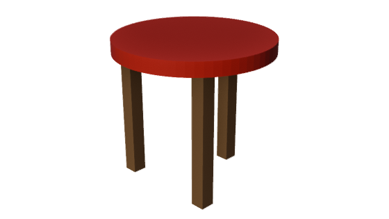

<div align="center">

# Blender Agent

**让 Claude Code、Codex 与 MCP 宿主在真实 Blender 中建模、看图和交付。**

[](https://nodejs.org/)
[](https://modelcontextprotocol.io/)
[](LICENSE)

[快速开始](#快速开始) · [使用指南](docs/portable/使用指南.md) · [本地分发](docs/distribution.md) · [验收记录](docs/acceptance-report.md)



*真实宿主验收截图：建模 → 看图 → 修改 → 保存 `.blend` → 导出 GLB。*

</div>

## 能做什么

Blender Agent 把 **15 个工具、33 类 / 217 个目录操作**交给现有 Agent。Skill 提供工作方法，CLI 与 MCP 共用 TypeScript 核心，几何计算由 Blender 自带 Python 执行。

| 目标 | 工作方式 |
| --- | --- |
| 建模与修改 | 查看场景、分步操作、每次关键修改后回看实际图像 |
| 按参考图还原 | 分析参考、核对尺度来源、白模确认、同机位检查 |
| 量测与装配检查 | 核对尺寸、位置、穿模和接口，保留检查回执 |
| 保存与交付 | 可编辑 `.blend`、GLB、预览图，以及按任务生成的验收记录 |
| 批处理与长任务 | 持久无头 worker、后台任务句柄、查询与清理 |

有 Blender 窗口时连接配套 addon 操作当前场景；没有窗口时使用持久无头会话，仍可返回真实图像。Blender 需要另行安装，包内包含 runtime、addon、Skill 和项目安装器，不依赖上游 checkout 或旧宿主。

## 快速开始

需要 **Node.js 22+、npm 和 Blender 4.x / 5.x**。Blender 自带所需 Python，无需另装系统 Python、uv 或 pip。

> 当前版本为 `1.0.0`，npm 包 `@blender-agent/bridge` **尚未公开发布**。现在可从有权限的源码仓库构建，或安装维护者提供的本地 `.tgz`；无需等待 CI。

### 从源码使用

仓库当前为私有，克隆需要相应 GitHub 权限。在 PowerShell 或终端中执行：

```sh
git clone https://github.com/patrickleehua/blender-server.git
cd blender-server
npm --prefix packages/blender-agent ci
npm run build
node packages/blender-agent/dist/cli.js help
node packages/blender-agent/dist/cli.js help install
```

把工具接入一个**已存在的项目目录**。先查看计划，再实际写入；将示例路径换成自己的路径：

```sh
node packages/blender-agent/dist/cli.js install --project "C:/my project" --host both --blender "C:/Program Files/Blender Foundation/Blender 4.5/blender.exe" --dry-run
node packages/blender-agent/dist/cli.js install --project "C:/my project" --host both --blender "C:/Program Files/Blender Foundation/Blender 4.5/blender.exe" --apply
```

`--project` 默认当前目录，`--host` 默认 `both`，也可选 `claude` 或 `codex`；省略 `--apply` 时仅预览。Blender 能自动发现时可省略 `--blender`。其他系统的路径和详细参数见 [使用指南](docs/portable/使用指南.md)。

### 安装本地 npm 包

从源码仓库生成独立安装包，再全局安装到稳定位置：

```sh
npm run pack
npm install -g ./release/blender-agent-bridge-1.0.0.tgz
blender-agent help
blender-agent install --help
blender-agent install --project "C:/my project" --dry-run
blender-agent install --project "C:/my project" --apply
```

已收到 `.tgz` 的使用者从 `npm install -g <包路径>` 开始即可，**不用编译，也不用保留源码仓库**。仍需 Node、Blender，以及 npm 安装依赖所需的网络或缓存。分发与将来发布 npm 的步骤见 [本地分发说明](docs/distribution.md)。

### 重新加载宿主，开始任务

安装器写入项目 Skill 与 MCP 配置。项目已有配置时保留原文件，生成候选供手工合并；遇到已修改文件的冲突会停止写入。**重新加载 Claude Code / Codex** 后，分别使用 `/blender-agent` 或 `$blender-agent`：

> 使用 blender-agent，在真实 Blender 中制作一个三腿圆凳。先查看场景和单位，保留已有对象；关键修改后实际看图。交付可编辑 blend、GLB、两张预览和尺寸检查记录，不要覆盖已有文件。

GUI 路线以 **`doctor.kind=ok`** 为就绪证据；无 GUI 则使用持久 worker。直接连续调用 CLI 时，先 `backend start`，并保持相同端口、工作目录、稳定 `--holder` 与 worker 名。完整步骤见 [启动与 doctor](docs/portable/使用指南.md#3-启动与-doctor)。

## 验证范围

[历史 MVP 验收](docs/acceptance-report.md)覆盖 Windows 上 Blender **4.5.15 / 5.0.1 无头**与 **4.5.15 GUI**；Claude **Opus 5.5 medium**、Codex **gpt-6.1-sol medium** 完成真实建模、原生图像查看和交付，产物由独立 Blender 进程重开检查。

该报告的哈希和结果只对应其中记录的旧制品；当前帮助、安装入口与独立包验证见[本轮分发验证](docs/distribution-verification.md)。Linux/macOS 尚无本项目真实机器验收记录；217 个操作也未穷举全部参数。`degraded` 不算通过。

## 常用命令

下表使用全局安装入口；源码运行时，将 `blender-agent` 换成 `node packages/blender-agent/dist/cli.js`。

| 命令 | 用途 |
| --- | --- |
| `blender-agent help` / `help install` | 查看总览或安装参数 |
| `blender-agent install --project "C:/my project" --apply` | 将 Skill 与 MCP 接入项目；不加 `--apply` 只预览 |
| `blender-agent uninstall --project "C:/my project" --apply` | 移除未修改的安装器自管文件 |
| `blender-agent doctor` | 检查 GUI 连接；以 `kind=ok` 为准 |
| `blender-agent tools` | 列出 15 个工具与输入 Schema |
| `blender-agent catalog --family audit` | 按能力类别查操作 |
| `blender-agent backend start` / `status` / `stop` | 管理连续 CLI 使用的持久后端 |

场景相关命令需带上当前实例的端口、工作目录和 Blender 参数；CLI 跨调用复用稳定 holder，具体见使用指南。

## 常见问题

**npm 安装为什么返回 404？**

当前 `@blender-agent/bridge` 尚未公开发布。先使用源码或本地 `.tgz` 安装；维护者的 npm 登录、scope 权限与发布流程见[分发说明](docs/distribution.md)。

**装完后找不到 `blender-agent` 命令？**

先重新打开终端，让终端刷新 npm 全局可执行路径。仍不可用时，按源码路线构建并使用 `node packages/blender-agent/dist/cli.js help`；安装包成功与 Shell 能找到命令是两步。

**项目已经有 MCP 配置怎么办？**

安装器保留原配置，生成 `.blender-agent/config-candidates/claude.json` 或 `codex.toml`。审阅后只合入 `blender-agent` 条目，再重新加载宿主。已修改的自管文件触发冲突时整次安装零写入。

**没有 Blender 窗口，doctor 没通过，还能用吗？**

可以使用持久无头 worker 并检查实际返回图像。`doctor.kind=ok` 是 GUI 路线的要求；无头不依赖 GUI addon。GUI 忙碌或暂停时需先处理当前场景状态，不会自动改用另一个场景。

## 开发与文档

```sh
npm test
node scripts/portable-setup-selftest.mjs
npm run pack
```

CLI 的 `help` / `--help` 查看说明，`tools` 查看工具合同，`catalog --family audit` 按类查操作。原 `node scripts/portable-setup.mjs --project <目录> ...` 入口继续兼容。

- [使用指南](docs/portable/使用指南.md)：项目接入、GUI / 无头、连续 CLI、升级与卸载。
- [本地分发](docs/distribution.md)：源码、tarball、npm 发布前提与维护者流程。
- [独立架构](docs/adapter-design.md)：共享核心、运行引擎与宿主的责任边界。
- [验收场景](docs/acceptance-scenarios.md)与[验收报告](docs/acceptance-report.md)：判据、产物和实际证据。
- [通用 Skill](skills/blender-agent/SKILL.md)：能力选择与建模闭环。

工具支持执行 Blender Python；分发为 npm 包不会隐藏实现，也没有新增任意 shell 工具。宿主仍负责授权与任务会话。

项目与复用引擎保留 **BSD-3-Clause** 许可；Skill 使用其随附 **MIT** 许可。来源与第三方声明见 [NOTICE.md](NOTICE.md)。Blender 是需另行安装的独立产品。
